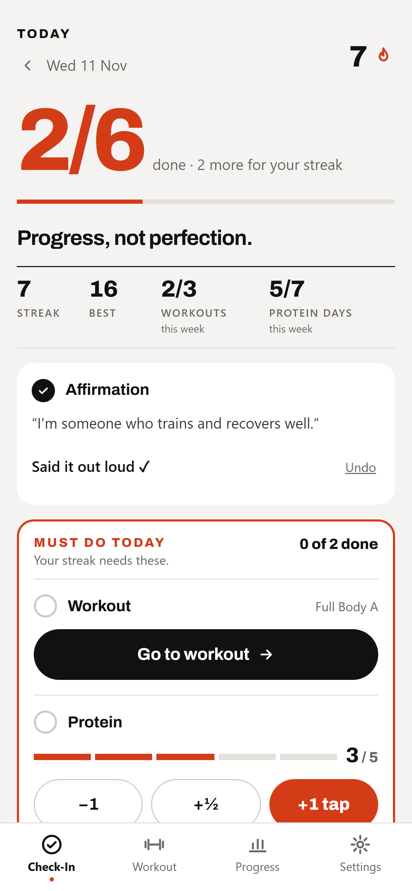
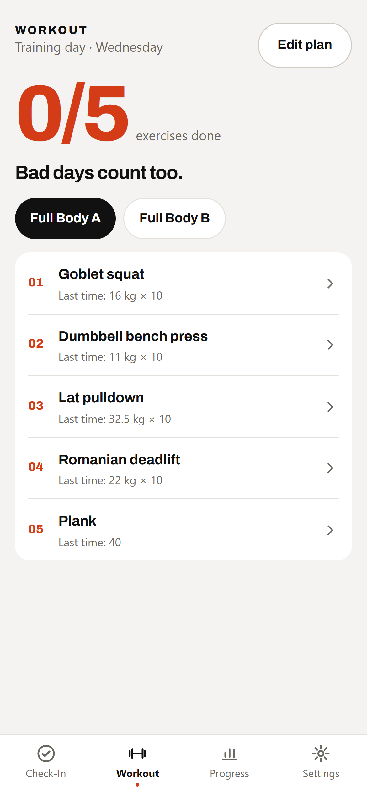
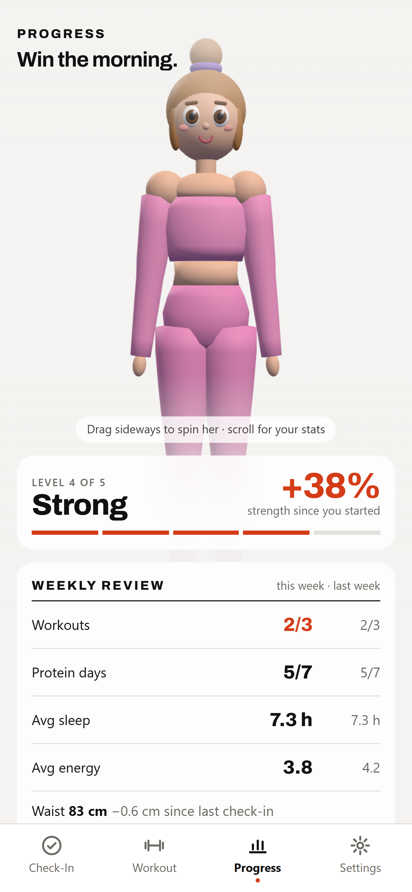
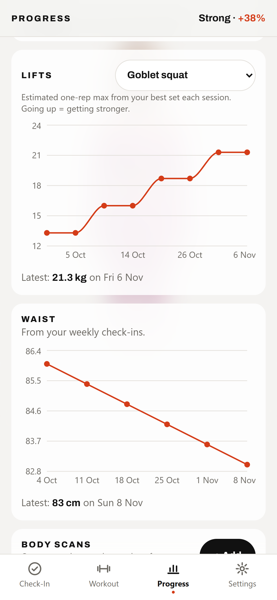

# Ori Health Tracker

A personal habit and progress tracker for a body recomposition journey: build muscle, lose fat.
It runs on my Android phone, and a full day takes under 30 seconds to log.

**Try it live → [ori-health-tracker.vercel.app](https://ori-health-tracker.vercel.app/)**
Everything is stored only in your own browser, so you start with an empty tracker and nothing you enter leaves your device.

> The source code is private. This repo is a showcase of the app and how it works.

---

## Screenshots

*Shown with made-up demo data.*

| Daily check-in | Workout | Progress | Lifts & waist |
|---|---|---|---|
|  |  |  |  |

---

## Built on *Atomic Habits*

The app follows the four laws of behaviour change from James Clear's *Atomic Habits*:

| Law | How the app does it |
|---|---|
| **Make it obvious** | One short daily checklist, with the two must-dos (protein and workout) boxed in coral at the top |
| **Make it attractive** | A daily motivation line, cheer messages, confetti, and a 3D character who gets stronger as you do |
| **Make it easy** | Taps instead of typing. Protein is counted in palm-sized servings, not grams. Workout sets are pre-filled from last time. There's a **two-minute version** for bad days. |
| **Make it satisfying** | Streaks, personal-record 🏆 celebrations, and charts that go the right way |

## Features

- **Daily check-in.** Affirmation (read it out loud and tap), steps, protein taps, sleep, energy and workout.
- **"Never miss twice" streak.** A day counts when 4 of 6 items are done and the must-dos are ticked. Missing one day is fine; missing two in a row breaks the streak.
- **Workout logger.** An editable A/B workout plan that rotates automatically. Sets are pre-filled from last time, and beating a previous best triggers a PR celebration.
- **Progress.** A 3D character (drag to spin) whose muscles grow with your strength gains, plus a weekly review comparing this week with last week, lift charts (estimated one-rep max), a waist chart and monthly body-scan numbers.
- **Weekly check-in.** Waist measurement and a progress-photo reminder.
- **Private by design.** No account and no server. Data lives on the phone, with export and import for backups.
- **Installable.** Works offline and installs to the home screen like a normal app (PWA).

## How it's built

| Part | Tool |
|---|---|
| App | React + Vite |
| Styling | Tailwind CSS |
| Charts | Recharts |
| 3D character | three.js (built from simple shapes in code, no model files) |
| Celebrations | canvas-confetti |
| Offline / install | vite-plugin-pwa |
| Storage | The browser's `localStorage`, all through one file so it can move to a database later |
| Hosting | Vercel |

Built in phases with the help of [Claude Code](https://claude.com/claude-code).
